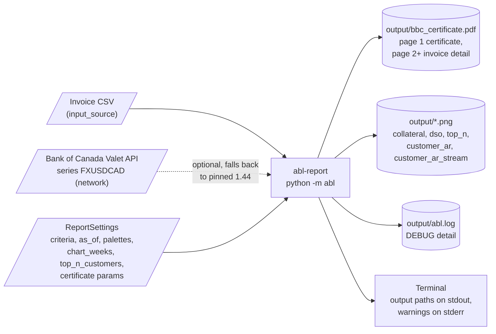
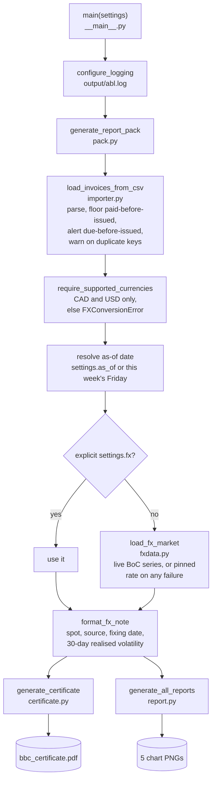
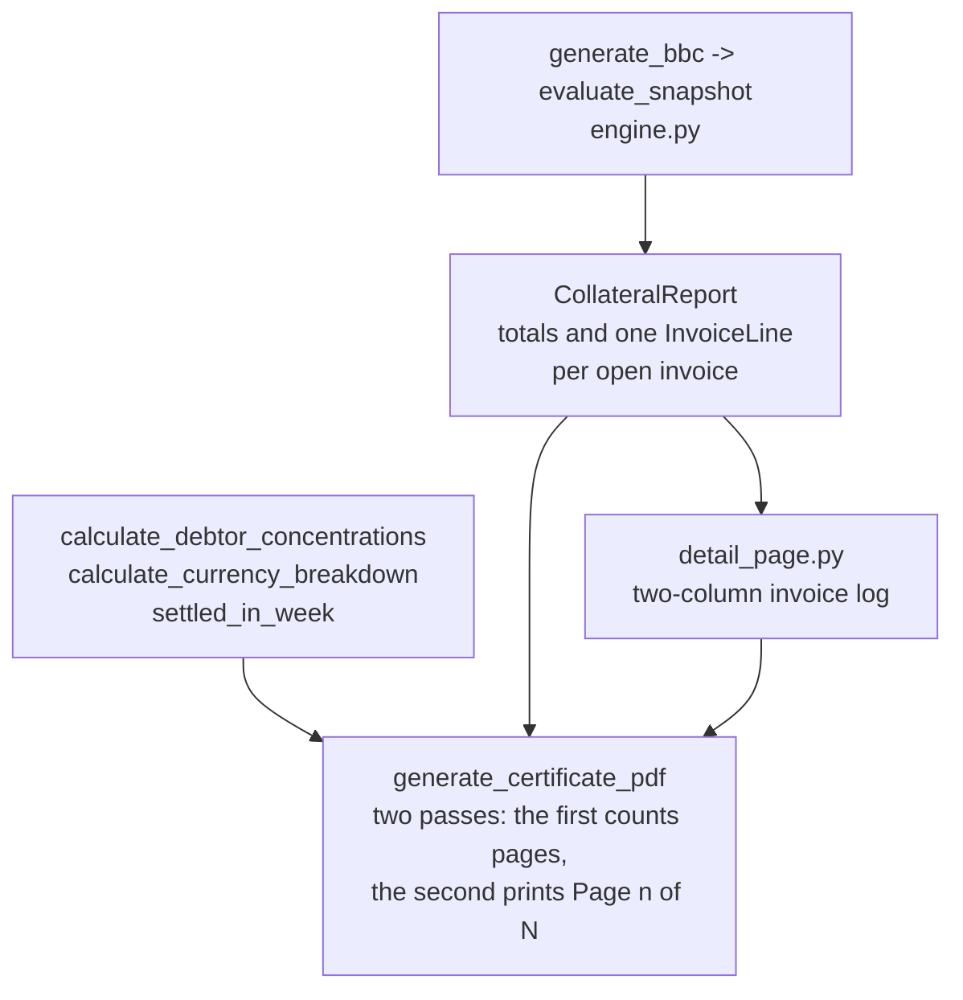
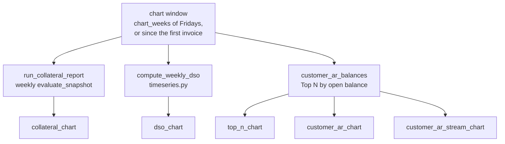
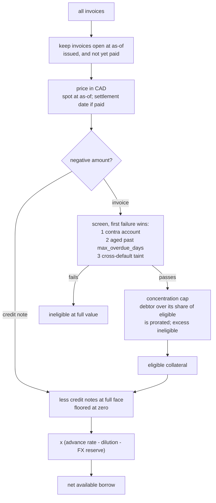

# System Flow: Inputs, Outputs and Run Sequence

How `abl-report` (`python -m abl`) turns an invoice extract into the Borrowing Base
Certificate and charts. Diagrams are Mermaid and render on GitHub. The certificate's
layout and maths are in [certificate_design.md](certificate_design.md).

## 1. Inputs and outputs

| Input | Where it comes from | Notes |
| --- | --- | --- |
| Invoice CSV | `ReportSettings.input_source` (`Path`, string or open text stream). The CLI default is set in `build_default_settings()` in `abl/__main__.py`. | Required columns: `Client Name, Invoice Date, Due Date, Invoice Amount, Currency, Invoice Paid Date`. Optional: `Invoice Key`. Dates are ISO `YYYY-MM-DD`. |
| USD/CAD rates | Bank of Canada Valet API, only when `fx_fetcher` is set. | A fetch failure or a coverage gap falls back to the pinned rate, labelled on the certificate. |
| Settings | `ReportSettings` (CLI: `build_default_settings()`). | Covenants, reserves, as-of date, palettes, chart window, certificate status and loan figures. |

| Output | Written by | Notes |
| --- | --- | --- |
| `bbc_certificate.pdf` | `certificate.py`, `detail_page.py` | Page 1 is the certificate; page 2 onward is the per-invoice audit log and settled-this-week list. |
| 5 chart PNGs | `report.py` | `collateral_chart`, `dso_chart`, `top_n_chart`, `customer_ar_chart`, `customer_ar_stream_chart`. A chart with no data is skipped. |
| `abl.log` | `__main__.configure_logging` | Rewritten each run. Rate fetches, skipped rates, data warnings and errors. |
| stdout / stderr | `__main__.main` | One `name: path` line per output. WARNING and above also go to stderr. |

## 2. Run sequence

Both branches get the same invoices, as-of date and FX provider, so the certificate and
the charts always agree on prices.

### 2a. Certificate branch

### 2b. Chart branch

Invoices before the window still count: they supply opening AR, DSO history and the
taint ratios.

## 3. Collateral engine (`evaluate_snapshot`)

The certificate then subtracts `existing_borrow` (a static figure in `CertificateParams`;
there is no loan ledger yet) to give Net Excess Availability.

## 4. Module map

| Module | Role |
| --- | --- |
| `__main__.py` | CLI entry point, logging, default settings |
| `pack.py` | One call: load, validate, price, then certificate and charts |
| `importer.py` | CSV to `Invoice`, with data checks |
| `models.py` | Dataclasses and settings (`ReportSettings`, `LendingCriteria`, ...) |
| `rules.py` | Pure covenant predicates and the borrowing-base arithmetic |
| `engine.py` | Snapshot evaluation and per-invoice audit lines |
| `fx.py`, `fxdata.py` | FX providers, currency checks, Bank of Canada fetch and volatility |
| `activity.py` | Invoices settled in the snapshot week |
| `certificate.py`, `detail_page.py` | PDF page 1 and the detail pages |
| `timeseries.py`, `runner.py`, `report.py` | Weekly DSO, AR and collateral series, and the charts |
| `bbc.py` | Thin wrapper that evaluates one snapshot for the certificate |
